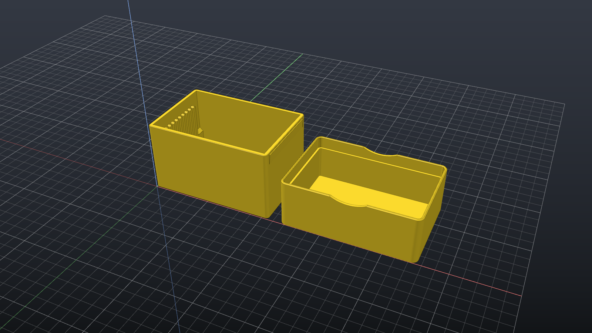

# OpenSCAD in Rust

Un'app desktop e un motore **OpenSCAD scritti da zero in Rust**: aprono i file `.scad`, li
valutano con un interprete nativo, mostrano il modello con la GPU ed esportano in STL.
Non serve OpenSCAD installato: il binario ufficiale viene usato solo come riferimento nei test
di compatibilità.



> **Stato: sviluppo iniziale (0.1).** Il linguaggio e il render 3D funzionano e sono verificati
> automaticamente contro OpenSCAD. Nome definitivo, Customizer, editor e assistente AI sono
> ancora da fare (vedi [Roadmap](#roadmap)).

## Perché

- **Interprete nativo**, non un wrapper di OpenSCAD: ogni triangolo sa da quale riga di codice
  nasce, il codice si può modificare senza perdere la formattazione (base per la modellazione
  diretta e per un assistente AI) e tutto sta in un unico eseguibile.
- **Compatibile con OpenSCAD**: messaggi, numeri e geometria sono confrontati automaticamente
  con OpenSCAD Nightly su centinaia di casi.
- **Veloce**: booleane con il kernel [Manifold](https://github.com/elalish/manifold), rendering
  con `wgpu` (Vulkan/DirectX 12), calcolo in background con annullamento.

## Cosa funziona

**Linguaggio.** Espressioni, funzioni e moduli, `let`, list comprehension, ricorsione profonda,
`include`/`use`, `children()`, variabili speciali `$fn`/`$fa`/`$fs` e `$`-dinamiche, quasi tutte le
funzioni builtin, `echo`/`assert`, `text()` con font inclusi, `fontmetrics()`/`textmetrics()`,
`object()`, librerie da `OPENSCADPATH` e `Documenti\OpenSCAD\libraries`.

**Geometria.** Primitive 2D e 3D tassellate esattamente come OpenSCAD, trasformazioni, `union` /
`difference` / `intersection`, `hull`, `minkowski`, `offset`, `linear_extrude`,
`rotate_extrude`, `projection`, `text`, `import` di STL/OFF, `surface` da file `.dat`, modificatori
`!`, `#`, `%`, `*`.

**App.**
- Apre `.scad` e `.stl` dal menu, trascinandoli nella finestra o da riga di comando.
- Ricarica automatica quando il file o le sue dipendenze cambiano su disco: si può modificare il
  codice nel proprio editor preferito e vedere il risultato subito.
- Console con i messaggi di OpenSCAD (`ECHO`, `WARNING`, `ERROR`) e la posizione nel codice.
- Viste predefinite, prospettiva/ortogonale, griglia, assi, spigoli; `#` in rosso e `%` in grigio
  trasparenti.
- Export STL binario o ASCII.
- Impostazioni persistenti, compresa la frequenza dei fotogrammi costante per evitare lo
  sfarfallio sui monitor G-Sync/VRR (soprattutto OLED).

**Riga di comando.** `scadr` accetta gli stessi parametri principali di `openscad`.

### Compatibilità misurata

| Suite | Casi | Risultato |
|---|---|---|
| Testuale (messaggi + albero CSG, byte per byte) | 217 | **217/217** identici |
| Geometrica (volume, area, ingombro, vertici delle mesh) | 100 | 39 identici, 60 equivalenti, 1 differenza nota |

La differenza nota (`linear_extrude` con `scale` non uniforme) è un'area diversa dello 0,01%.

## Requisiti

Per ora solo **Windows 10/11** (il codice è pensato per macOS e Linux, non ancora provati).

- [Rust](https://rustup.rs) tramite `rustup`: la versione esatta (1.99) viene installata
  automaticamente grazie a `rust-toolchain.toml`.
- [Visual Studio Build Tools 2022](https://visualstudio.microsoft.com/visual-cpp-build-tools/)
  con il carico di lavoro **"Sviluppo di applicazioni desktop con C++"** (serve a compilare
  Manifold).
- [CMake](https://cmake.org) 3.18 o successivo nel `PATH`.
- Una GPU con Vulkan o DirectX 12.
- Facoltativo, solo per rigenerare i risultati attesi dei test:
  [OpenSCAD Nightly](https://openscad.org/downloads.html#snapshots).

## Compilare e avviare

```powershell
git clone <url-del-repository>
cd <cartella>
cargo run -p app                          # avvia l'app
cargo run -p app -- examples\supporto.stl # apre direttamente un file
cargo build --release -p app -p scadr     # eseguibili ottimizzati in target\release
```

La prima compilazione richiede qualche minuto (Manifold è in C++); le successive sono rapide.

### Scorciatoie dell'app

| Tasto | Azione |
|---|---|
| `Ctrl+O` | Apri file |
| `Ctrl+E` | Esporta STL |
| `F5` | Ricarica |
| `F` | Inquadra il modello |
| Mouse sinistro / destro (o centrale) / rotella | Ruota / sposta / zoom |

## Riga di comando (`scadr`)

```powershell
scadr -o modello.stl modello.scad                 # STL ASCII (come OpenSCAD)
scadr -o modello.stl --export-format binstl modello.scad
scadr -o modello.off modello.scad
scadr -o modello.csg modello.scad                 # albero CSG
scadr -o modello.echo modello.scad                # solo i messaggi
scadr -D "larghezza=40" -D "testo=\"ciao\"" -o out.stl modello.scad
scadr -L C:\mie\librerie -o out.stl modello.scad
```

Messaggi, formato dei file ed exit code seguono quelli di OpenSCAD.

## Test

```powershell
cargo test --workspace                            # test unitari e di integrazione
cargo build -p scadr; cargo run -p compat-runner  # suite testuale contro OpenSCAD
cargo run -p compat-runner -- --geometry -v       # suite geometrica contro OpenSCAD
cargo clippy --workspace --all-targets
cargo fmt --all --check
```

Le suite di compatibilità confrontano il nostro output con quello di OpenSCAD salvato in
`tests/compat` (dettagli in [tests/compat/README.md](tests/compat/README.md)); OpenSCAD serve solo
per aggiungere casi nuovi. La CI su GitHub Actions esegue tutti questi controlli.

## Struttura

```
crates/
  scad-syntax/   lexer, parser con albero sintattico lossless (rowan), AST
  scad-eval/     interprete e funzioni builtin
  scad-font/     font, shaping e contorni per text()
  geometry/      mesh, albero CSG con riferimenti al codice sorgente
  manifold/      kernel CSG Manifold (C++, incluso nel repository) con binding Rust sicuri
  mesher/        albero CSG → mesh, tassellazione identica a OpenSCAD
  mesh-io/       lettura e scrittura STL/OFF
  render/        rendering wgpu (anche senza finestra, verso PNG)
  scadr/         eseguibile a riga di comando
  app/           interfaccia egui
tools/
  compat-runner/ confronto automatico con OpenSCAD
tests/compat/    casi di test e risultati attesi di OpenSCAD
examples/        modelli di esempio
docs/            note tecniche e piano di lavoro
```

Documentazione per chi sviluppa:
- [CLAUDE.md](CLAUDE.md): decisioni, architettura, stato e comandi.
- [docs/next-steps.md](docs/next-steps.md): prossimi passi dettagliati e regole del progetto.
- [docs/openscad-behavior.md](docs/openscad-behavior.md): comportamento di OpenSCAD osservato
  dall'esterno, usato come specifica.

## Roadmap

1. [x] Fondamenta: finestra, viewer GPU, STL
2. [x] Linguaggio OpenSCAD completo
3. [x] Render 3D ed export STL
4. [ ] Customizer: parametri dai commenti, slider, preset
5. [ ] Import SVG/DXF/3MF/OBJ, export 3MF/OBJ, ultimi casi geometrici
6. [ ] Compatibilità con librerie reali (BOSL2, MCAD)
7. [ ] Assistente AI integrato (Claude, Gemini)
8. [ ] Modellazione diretta

## Contribuire

Il motore è sviluppato in modo **clean-room**: si basa sulla documentazione di OpenSCAD e sul
comportamento osservato del suo eseguibile, senza copiarne il codice sorgente. Prima di
contribuire leggere le regole in [docs/next-steps.md](docs/next-steps.md).

## Licenza

Distribuito con licenza [GNU GPL v3.0 o successiva](LICENSE).

Componenti di terze parti inclusi nel repository:

| Componente | Percorso | Licenza |
|---|---|---|
| [Manifold](https://github.com/elalish/manifold) 3.5.4 | `crates/manifold/vendor/manifold` | Apache-2.0 |
| [Clipper2](https://github.com/AngusJohnson/Clipper2) | `crates/manifold/vendor/clipper2` | BSL-1.0 |
| [Liberation Fonts](https://github.com/liberationfonts/liberation-fonts) 2.00.1 | `crates/scad-font/fonts` | SIL OFL 1.1 |

Le dipendenze Rust sono elencate in `Cargo.lock`, ognuna con la propria licenza.

Questo progetto non è affiliato con il progetto OpenSCAD. OpenSCAD è usato solo come
riferimento per i test di compatibilità.
